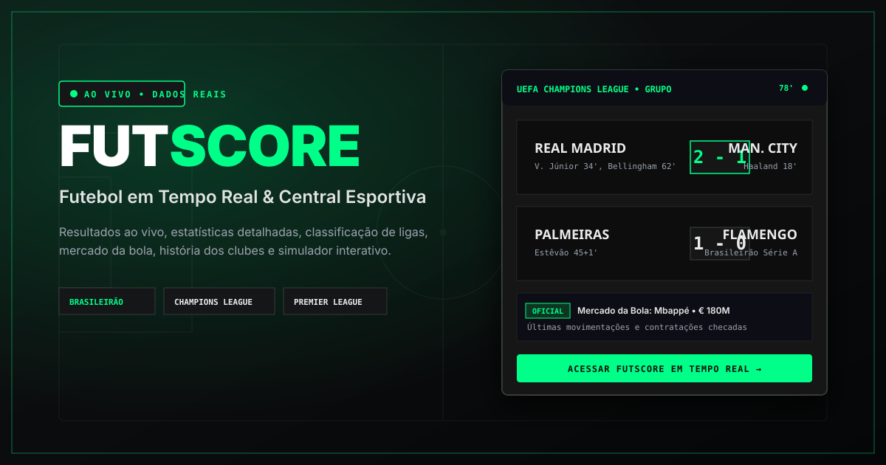

# 🏆 OmniScore — Central Multiesportiva em Tempo Real & Plataforma Tática

<div align="center">



[](https://react.dev/)
[](https://www.typescriptlang.org/)
[](https://vitejs.dev/)
[](https://tailwindcss.com/)
[](https://recharts.org/)
[](https://ai.google.dev/)
[](#licença)

**Acompanhe resultados ao vivo de todos os esportes, radar comparativo de competências, probabilidades D3, previsões táticas com IA Gemini, Modo Treinador e motor de áudio realista de arena.**

[🌐 Visão Geral](#-visão-geral) • [⚡ Modalidades Esportivas](#-modalidades-esportivas-cobertas) • [✨ Funcionalidades](#-funcionalidades) • [🔊 Motor de Áudio Realista](#-motor-de-áudio-realista-web-audio-api) • [🚀 Como Executar](#-como-executar-o-projeto)

</div>

---

## 📌 Visão Geral

O **OmniScore** (anteriormente FutScore) é uma plataforma esportiva completa, moderna e responsiva projetada para acompanhar eventos esportivos de elite em tempo real. Com visual sombrio esportivo de alta legibilidade (*carbon black* e toques neon `#00ff88`), a aplicação integra dados detalhados, estatísticas oficiais, gráficos interativos e inteligência artificial para múltiplos esportes tanto no desktop quanto no mobile.

---

## ⚡ Modalidades Esportivas Cobertas

O OmniScore vai além do futebol tradicional, trazendo dados em tempo real e pontuações parciais dedicadas:

| Modalidade | Ícone | Principais Competições & Estatísticas |
| :--- | :---: | :--- |
| **Futebol** | ⚽ | Brasileirão Série A, Champions League, Premier League, La Liga, Libertadores • xG, posse, chutes, desfalques, mapas de calor |
| **Basquete** | 🏀 | NBA & NBB Brasil • Parciais por 4 quartos, FG%, bolas de 3 pts, rebotes, tocos e assistências |
| **Hóquei no Gelo** | 🏒 | NHL Stanley Cup & Mundial IIHF • Parciais por 3 períodos, chutes a gol (SOG), defesas de goleiro e penalidades |
| **Vôlei** | 🏐 | Superliga Masculina/Feminina Bet7k & Liga das Nações (VNL) • Pontuação set a set, aces, bloqueios e ralis |
| **Natação** | 🏊 | Mundial Aquatics & Troféu Brasil • Provas de 50m a 400m Medley, tempo de piscina, parciais e recordes mundiais |
| **Jiu-Jitsu** | 🥋 | Mundiais IBJJF & ADCC Submission Fighting • Pontos, vantagens, punições, divisões de peso e finalizações |
| **Judô** | 🥋 | Circuito Mundial IJF & Grand Slam de Paris • Ippon, Waza-ari, penalidades Shido e Golden Score |
| **MMA** | 🥊 | UFC & PFL • Golpes significativos, quedas (takedowns), tentativas de finalização e rounds |
| **Tênis** | 🎾 | Grand Slams (Roland Garros, Wimbledon) & ATP/WTA • Parciais por sets, tie-breaks, aces e quebras |

---

## ✨ Funcionalidades Principais

### 1. 📊 Radar de Competências com Recharts
Gráfico de teia polar (*radar chart*) integrado tanto na aba de estatísticas quanto na aba dedicada:
- **Eixos Comparados:** Posse de Bola, Chutes (volume e pontaria no alvo), Passes (volume e precisão percentual) e Ataques Perigosos (xG, grandes chances e escanteios).
- **Modos de Visualização:** Métricas Fundamentais (4 eixos), Competências Táticas (Ataque, Defesa, Disciplina, Criação) e Visão Expandida (6 eixos).
- **Filtros de Exibição:** Ambos os times, apenas mandante ou apenas visitante.

### 2. 🧠 Previsões Táticas com IA Gemini 3.8 Flash
- Análise preditiva profunda gerada pela API do Gemini.
- Cruza histórico de confrontos, forma recente, peso da camisa e lesões para calcular probabilidades de vitória, empate e cenários de jogo.

### 3. 📋 Modo Treinador Interativo (Prancheta Tática)
- Assuma o comando técnico de qualquer partida em andamento.
- Altere formações táticas (*4-3-3*, *4-2-3-1*, *3-5-2*, *5-4-1*), ajuste postura mental e realize substituições em tempo real para ver o impacto no momentum e placar.

### 4. 🔴 Placares Ao Vivo & Ticker Multiesportivo
- Ticker horizontal com todas as partidas do dia e eventos ao vivo.
- Filtros rápidos por modalidade esportiva, status (*Ao Vivo*, *Encerrados*, *Agendados*) e partidas favoritadas.
- Calendário inteligente com seletor diário e visão mensal.

### 5. 📜 Histórico de Confrontos Diretos (H2H)
- Retrospecto dos últimos 5 jogos entre os adversários com data, placar, autores dos gols e estatísticas comparativas de vitórias e empates.

### 6. 🔥 Mapa de Calor e Zonas de Pressão Territorial
- Renderização em SVG com gradientes dinâmicos indicando os setores do campo com maior dominância e pressão ofensiva de cada equipe.

### 7. 📺 Guia Onde Assistir (TV & Streaming)
- Mapeamento completo dos canais de transmissão oficiais de cada partida e combate: *Globo, SporTV, Premiere, CazéTV, ESPN, Disney+, Band, Max/TNT e canais de streaming*.

### 8. 👤 Central de Craques & Perfis de Atletas
- Fichas técnicas aprofundadas com biografia, clube atual, valor de mercado em Euros (€) e Reais (R$), histórico de clubes, galeria de troféus e estatísticas na temporada.

---

## 🔊 Motor de Áudio Realista (Web Audio API)

O OmniScore conta com um sintetizador acústico procedural de alta fidelidade desenvolvido sobre a **Web Audio API**:

- **Acústica Espacial de Estádio (Convolution Reverb):**
  - Resposta ao impulso gerada algoritmicamente simulando a reverberação de uma arena de 50.000 lugares com reflexões primárias nas arquibancadas (25ms a 165ms) e amortecimento natural de altas frequências no ar.
- **Apito de Árbitro Fox 40 Classic:**
  - Dupla frequência ressonante discordante (~2820 Hz e ~3140 Hz) produzindo o batimento acústico característico, acompanhado de trill flutter de 32 Hz e sopro de ar inicial.
- **Trompa de Gol & Explosão de Torcida:**
  - Acorde potente de trompa de arena (D2, A2, D3, F#3) com sub-grave de 50 Hz e camadas de ruído estéreo moduladas por filtros formantes vocais ("OOH -> GOOOL").
- **Buzzer Eletrônico de Basquete (NBA/NBB):**
  - Sirene elétrica de 120 Hz com harmônicos pontiagudos e ruído de fricção do atrito da bola na rede (*swish*).
- **Sino Metálico de Luta (Bronze):**
  - Bronze fundido autêntico com fundamental a 840 Hz e parciais inarmônicos de longa sustentação.

---

## 🚀 Como Executar o Projeto

### Pré-requisitos
- [Node.js](https://nodejs.org/) versão 18 ou superior.
- [npm](https://www.npmjs.com/) ou [bun](https://bun.sh/).

### Instalação

```bash
# 1. Clone o repositório
git clone https://github.com/<seu-usuario>/omniscore.git

# 2. Acesse a pasta do projeto
cd omniscore

# 3. Instale as dependências
npm install

# 4. Inicie o servidor de desenvolvimento
npm run dev
```

Abra seu navegador em [http://localhost:3000](http://localhost:3000).

---

## ⚡ Deploy no Vercel (Passo a Passo)

O OmniScore está 100% preparado e otimizado para deploy na **[Vercel](https://vercel.com/)** com um clique ou via GitHub:

### 1. Configurações Pré-configuradas no Projeto
- **`vercel.json`:** Configurado com rewrites SPA (`/index.html`), cabeçalhos de segurança (*nosniff, sameorigin, referrer-policy*) e cache otimizado de assets e `ads.txt`.
- **`.vercelignore`:** Exclui diretórios desnecessários e dependências para deploys ultrarrápidos.
- **Serverless Functions:** As rotas em `/api/ai/predict-match` e `/api/ai/coach-advice` executam como Vercel Serverless Functions automáticas.

### 2. Passo a Passo de Deploy na Vercel

1. Envie seu repositório para o **GitHub**:
   ```bash
   git add .
   git commit -m "feat: preparar para Vercel e Google AdSense"
   git push origin main
   ```
2. Acesse [vercel.com](https://vercel.com/) e clique em **"Add New Project"** > **"Import Git Repository"**.
3. Selecione o repositório do **OmniScore**.
4. A Vercel detectará o preset **Vite**:
   - **Framework Preset:** `Vite`
   - **Build Command:** `npm run build`
   - **Output Directory:** `dist`
   - **Install Command:** `npm install`
5. Na seção **Environment Variables**, adicione suas variáveis:
   - `GEMINI_API_KEY`: Sua chave de API do Google Gemini (obtenha em [aistudio.google.com](https://aistudio.google.com/)).
   - `VITE_ADSENSE_CLIENT_ID`: Seu ID do Google AdSense (ex: `ca-pub-1234567890123456`).
   - `VITE_ADSENSE_SLOT_TOP_BANNER`: ID do slot de anúncio do banner inicial.
   - `VITE_ADSENSE_SLOT_FEED`: ID do slot de anúncio entre os jogos.
   - `VITE_ADSENSE_SLOT_MODAL`: ID do slot de anúncio do modal de jogo.
   - `VITE_ADSENSE_TEST_MODE`: `false` (para exibir anúncios reais) ou `true` (para testar layout).
6. Clique em **Deploy**. Seu app estará no ar com HTTPS em menos de 2 minutos!

---

## 💰 Monetização com Google AdSense

O OmniScore inclui infraestrutura nativa e em conformidade com as políticas do Google AdSense:

### 1. Arquivo `ads.txt`
O arquivo `public/ads.txt` é servido automaticamente na raiz do seu domínio (`seusite.com/ads.txt`):
```text
google.com, pub-0000000000000000, DIRECT, f08c47fec0942fa0
```
> **Importante:** Substitua `pub-0000000000000000` pelo seu número real de editor AdSense (sem o prefixo `ca-`).

### 2. Verificação de Propriedade do Site
A tag `<meta name="google-adsense-account" content="ca-pub-..." />` e o script oficial do AdSense (`pagead2.googlesyndication.com`) são injetados de forma dinâmica e segura assim que você define `VITE_ADSENSE_CLIENT_ID`, evitando chamadas inválidas ou erros 400 em ambiente local.

### 3. Posicionamento Estratégico dos Blocos de Anúncios
- **Banner Principal (`AdSenseBanner - Top`):** Posicionado na página inicial logo abaixo do seletor de clubes favoritos e antes da seção de esportes, capturando alto engajamento.
- **In-Feed (`AdSenseBanner - Feed`):** Integrado fluidamente a cada 4 partidas no grid de jogos da `MatchesView`, respeitando a proporção da tela sem atrapalhar a experiência do torcedor.
- **Modal de Detalhes (`AdSenseBanner - Modal`):** Localizado no final das estatísticas e radar do modal, capturando visualizações qualificadas durante a leitura do jogo.

### 4. Modo de Teste / Demonstração
Quando `VITE_ADSENSE_TEST_MODE="true"` ou quando nenhuma chave está configurada, os banners exibem uma moldura elegante e translúcida no padrão visual escuro do app, com guia explicativo de ativação e sem risco de violação de tráfego inválido.

---

## 🛠️ Tecnologias Utilizadas

- **Framework:** [React 19](https://react.dev/)
- **Linguagem:** [TypeScript 5.8](https://www.typescriptlang.org/)
- **Bundler:** [Vite 6](https://vitejs.dev/)
- **Hospedagem & Serverless:** [Vercel](https://vercel.com/)
- **Monetização:** Google AdSense (com `ads.txt` e in-feed responsivo)
- **Estilização:** [Tailwind CSS v4](https://tailwindcss.com/)
- **Gráficos:** [Recharts 2.15](https://recharts.org/)
- **Inteligência Artificial:** Google Gemini SDK (`@google/genai`)
- **Áudio:** Web Audio API com Convolver Reverb e síntese procedural
- **Ícones:** [Lucide React](https://lucide.dev/)

---

## 📄 Licença

Este projeto está sob a licença [MIT](https://opensource.org/licenses/MIT).

